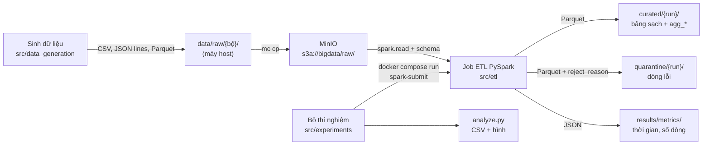
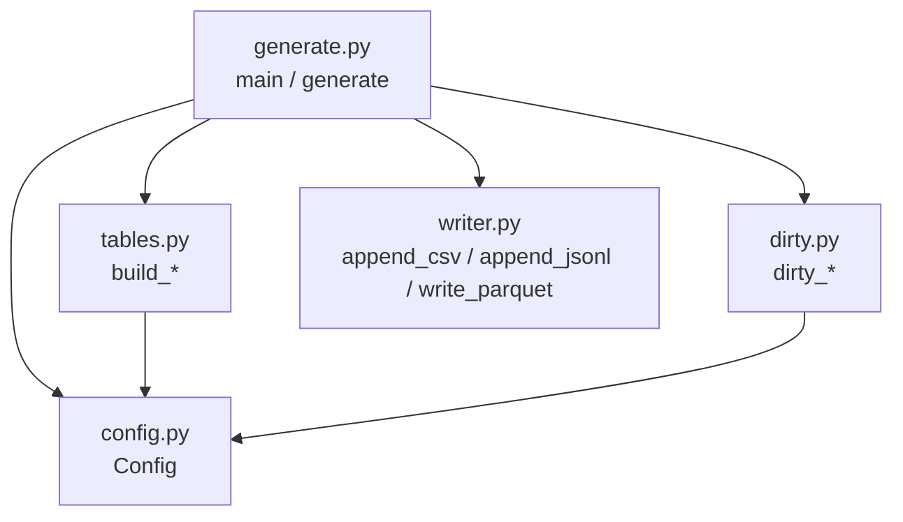
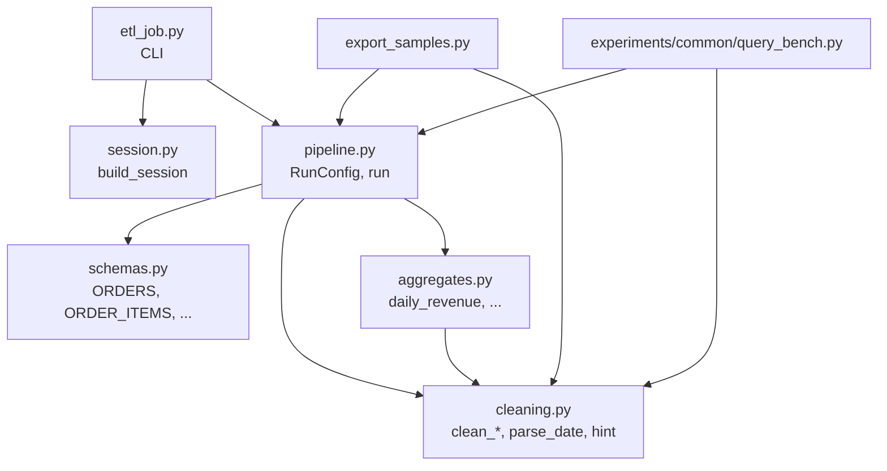
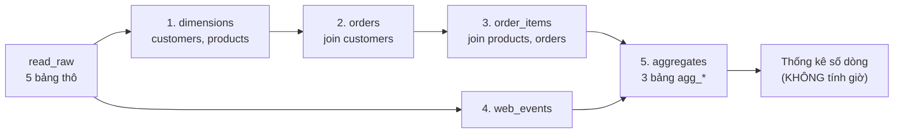
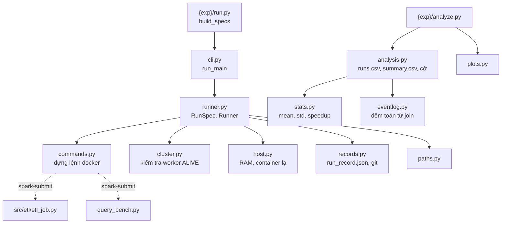
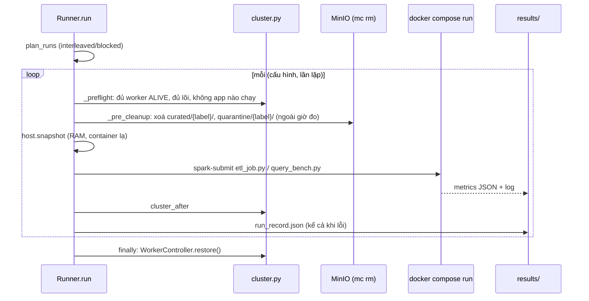
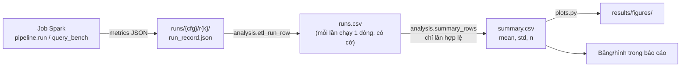

# Giải thích mã nguồn (CodeBase)

Tài liệu đọc mã cho nhóm, dùng để ôn trước buổi vấn đáp. Mỗi mục nêu file làm gì, hàm chính nằm ở dòng nào (bấm link để mở đúng dòng), file đó gọi file nào và vì sao viết như vậy.

- Tài liệu này **không chứa số đo**. Mọi con số (thời gian, speedup, số dòng) lấy từ `results/`, xem [mục 11](#11-truy-vết-một-con-số-từ-báo-cáo-về-mã).
- Dữ liệu là **dữ liệu mô phỏng** sinh bằng script (seed 42), không phải dữ liệu thật.
- Link có dạng `file.py#L42` mở đúng dòng 42 trên GitHub và trong VS Code. Nếu sửa mã làm lệch dòng thì cập nhật lại link.

## Mục lục

1. [Tổng quan: hệ thống làm gì](#1-tổng-quan-hệ-thống-làm-gì)
2. [Cây thư mục mã nguồn](#2-cây-thư-mục-mã-nguồn)
3. [Luồng chạy từ đầu đến cuối](#3-luồng-chạy-từ-đầu-đến-cuối)
4. [Hạ tầng: Docker Compose (Spark + MinIO)](#4-hạ-tầng-docker-compose-spark--minio)
5. [Sinh dữ liệu mô phỏng (`src/data_generation/`)](#5-sinh-dữ-liệu-mô-phỏng-srcdata_generation)
6. [Job ETL PySpark (`src/etl/`)](#6-job-etl-pyspark-srcetl)
7. [Bộ thí nghiệm hiệu năng (`src/experiments/`)](#7-bộ-thí-nghiệm-hiệu-năng-srcexperiments)
8. [Baseline Pandas một máy](#8-baseline-pandas-một-máy)
9. [Kiểm thử (`tests/`)](#9-kiểm-thử-tests)
10. [Dựng báo cáo Word (`report/build/`)](#10-dựng-báo-cáo-word-reportbuild)
11. [Truy vết một con số từ báo cáo về mã](#11-truy-vết-một-con-số-từ-báo-cáo-về-mã)
12. [Câu hỏi vấn đáp thường gặp](#12-câu-hỏi-vấn-đáp-thường-gặp)
13. [Tra nhanh: muốn tìm X thì mở file nào](#13-tra-nhanh-muốn-tìm-x-thì-mở-file-nào)

---

## 1. Tổng quan: hệ thống làm gì

Đồ án phụ trách đoạn **Storage → Processing** trong pipeline Big Data
(Sources → Ingestion → **Storage → Processing** → Analytics → Presentation → Decision/Action).



Ba thành phần mã chính:

| Thành phần | Chạy ở đâu | Vai trò | Mục |
|---|---|---|---|
| [src/data_generation/](../src/data_generation/) | Python trên host | Sinh 5 bảng thương mại điện tử, chèn dữ liệu bẩn có kiểm soát, ghi `manifest.json` | [5](#5-sinh-dữ-liệu-mô-phỏng-srcdata_generation) |
| [src/etl/](../src/etl/) | PySpark trong cụm Docker | Đọc thô từ MinIO, làm sạch, join, tổng hợp, ghi Parquet, ghi metrics | [6](#6-job-etl-pyspark-srcetl) |
| [src/experiments/](../src/experiments/) | Python trên host điều khiển Docker | Chạy lặp 7 thí nghiệm, kiểm tra cụm, ghi run record, phân tích, vẽ hình | [7](#7-bộ-thí-nghiệm-hiệu-năng-srcexperiments) |

---

## 2. Cây thư mục mã nguồn

Chỉ liệt kê file mã; tài liệu và kết quả xem [README gốc](../README.md).

```text
infra/
  docker-compose.yml        cụm: minio, minio-init, spark-master, spark-worker-1, spark-worker-2
  .env.example              image, mật khẩu MinIO (mẫu), lõi/RAM mỗi worker
src/
  data_generation/
    config.py               hằng số + dataclass Config (tham số sinh)
    tables.py               dựng bảng sạch
    dirty.py                chèn lỗi (thiếu, sai, mồ côi, sai định dạng ngày, trùng)
    writer.py               ghi CSV / JSONL / Parquet theo khối
    generate.py             CLI: điều phối, ghi manifest.json
  etl/
    session.py              tạo SparkSession (ANSI, AQE, S3A)
    schemas.py              schema tường minh cho dữ liệu thô
    cleaning.py             quy tắc làm sạch, chuẩn hoá ngày, gợi ý join
    aggregates.py           3 bảng tổng hợp
    pipeline.py             điều phối các giai đoạn, đo giờ, ghi metrics
    etl_job.py              CLI cho spark-submit
    smoke_s3a.py            kiểm tra Spark <-> MinIO
    export_samples.py       xuất mẫu CSV trước/sau xử lý + đối chiếu số dòng
  experiments/
    common/                 mã dùng chung (xem mục 7.1)
    scale_data/  scale_workers/  format_compare/  join_strategy/
    skew/  cache/  pandas_baseline/      mỗi thư mục: run.py + analyze.py
    run_all.py  analyze_all.py  cleanup.py
tests/                      pytest cho từng module
report/build/               dựng file Word từ Markdown, vẽ sơ đồ
```

---

## 3. Luồng chạy từ đầu đến cuối

Các lệnh đầy đủ ở [README gốc](../README.md#chạy-thử-từ-máy-trống) và [infra/README.md](../infra/README.md). Ở đây chỉ nêu mỗi bước gọi file nào.

| Bước | Lệnh (rút gọn) | File được gọi | Kết quả |
|---|---|---|---|
| 1. Sinh dữ liệu | `python -m src.data_generation.generate --orders 500000` | [generate.py `main`](../src/data_generation/generate.py#L120) → [`generate`](../src/data_generation/generate.py#L48) | `data/raw/orders_500k/*.csv/.jsonl/.parquet` + `manifest.json` |
| 2. Dựng cụm | `docker compose up -d` (trong `infra/`) | [docker-compose.yml](../infra/docker-compose.yml) | MinIO + 1 master + 2 worker |
| 3. Đưa dữ liệu lên MinIO | `docker compose run --rm minio-init cp --recursive /data/raw/orders_500k local/bigdata/raw/` | dịch vụ [`minio-init`](../infra/docker-compose.yml#L35) | `s3a://bigdata/raw/orders_500k/` |
| 4. (Một lần) kiểm tra kết nối | `spark-submit .../smoke_s3a.py` | [smoke_s3a.py](../src/etl/smoke_s3a.py#L26) | dòng `SMOKE_OK` |
| 5. Chạy ETL | `spark-submit ... src/etl/etl_job.py --dataset orders_500k` | [etl_job.py `main`](../src/etl/etl_job.py#L29) → [pipeline.py `run`](../src/etl/pipeline.py#L90) | `curated/`, `quarantine/` trên MinIO; `results/metrics/orders_500k.json`; dòng `ETL_OK` |
| 6. Xuất mẫu trước/sau | `spark-submit ... src/etl/export_samples.py --dataset orders_5m` | [export_samples.py `main`](../src/etl/export_samples.py#L248) | `results/samples/orders_5m/*.csv` |
| 7. Chạy thí nghiệm | `python -m src.experiments.run_all --group all` | [run_all.py](../src/experiments/run_all.py#L22) → từng `run.py` → [runner.py `Runner.run`](../src/experiments/common/runner.py#L187) | `results/metrics/<exp>/runs/...`, `results/logs/<exp>/` |
| 8. Phân tích | `python -m src.experiments.analyze_all` | [analyze_all.py](../src/experiments/analyze_all.py#L18) → từng `analyze.py` | `runs.csv`, `summary.csv`, hình trong `results/figures/` |
| 9. Dựng báo cáo | `python report/build/build_docx.py` | [build_docx.py](../report/build/build_docx.py#L1616) | `report/bao-cao.docx` |

---

## 4. Hạ tầng: Docker Compose (Spark + MinIO)

File: [infra/docker-compose.yml](../infra/docker-compose.yml), biến môi trường mẫu: [infra/.env.example](../infra/.env.example).

| Dịch vụ | Dòng | Vai trò |
|---|---|---|
| `x-spark-common` | [L5–L17](../infra/docker-compose.yml#L5-L17) | Cấu hình chung của mọi container Spark: image, khoá MinIO qua biến môi trường `AWS_*`, gắn thư mục `data/`, `src/` (chỉ đọc), `results/` vào `/opt/spark/work-dir/` |
| `minio` | [L20–L31](../infra/docker-compose.yml#L20-L31) | Kho đối tượng tương thích S3; cổng 9000 (API), 9001 (giao diện web) |
| `minio-init` | [L35–L44](../infra/docker-compose.yml#L35-L44) | Tạo bucket `bigdata`; cũng dùng để chép `data/raw` lên MinIO và xoá thư mục cũ (`mc rm`) |
| `spark-master` | [L46–L51](../infra/docker-compose.yml#L46-L51) | Master chế độ standalone, giao diện tại cổng host 8090 |
| `spark-worker-1`, `spark-worker-2` | [L53–L77](../infra/docker-compose.yml#L53-L77) | Mỗi worker `SPARK_WORKER_CORES` lõi, `SPARK_WORKER_MEMORY` RAM (mẫu: 2 lõi, 2g); bật dọn thư mục ứng dụng cũ |

Điểm cần nhớ:

- **Giới hạn máy**: Docker Desktop/WSL2 bị giới hạn 6 GB, nên chỉ có 2 worker × 2g ([.env.example](../infra/.env.example)). Đây là giới hạn phải nêu trong báo cáo.
- **Driver chạy trong container riêng** tạo bằng `docker compose run --rm --name etl-driver`. Tên container được dùng làm `spark.driver.host` để executor gọi ngược về driver ([commands.py L45](../src/experiments/common/commands.py#L45)).
- **Không dùng `docker compose exec`** vì lệnh này từng làm sập Docker Desktop trên máy thí nghiệm ([commands.py L3–L4](../src/experiments/common/commands.py#L3-L4), [infra/README.md](../infra/README.md)).
- **Kết nối S3A**: gói `org.apache.hadoop:hadoop-aws` được tải qua `--packages` ([commands.py L58](../src/experiments/common/commands.py#L58)); cấu hình endpoint và khoá nằm ở [session.py L19–L25](../src/etl/session.py#L19-L25). Khoá lấy từ biến môi trường, không viết cứng.

---

## 5. Sinh dữ liệu mô phỏng (`src/data_generation/`)

README: [src/data_generation/README.md](../src/data_generation/README.md). Schema chi tiết: [docs/design/schema.md](design/schema.md).

### 5.1. Quan hệ giữa các file



### 5.2. Từng file

**[config.py](../src/data_generation/config.py)**: hằng số và tham số.
- Khoảng ngày đơn hàng 2024-01-01 đến 2025-12-31 ([L7–L8](../src/data_generation/config.py#L7-L8)); trạng thái đơn và tỉ trọng ([L12–L13](../src/data_generation/config.py#L12-L13)).
- Các định dạng ngày "sai" dùng để chèn lỗi ([L26–L27](../src/data_generation/config.py#L26-L27)).
- [`Config`](../src/data_generation/config.py#L33): `orders`, `seed=42`, `dirty_rate=0.02`, `skew`, `hot_products=10`, `hot_share=0.5`... `__post_init__` từ chối tham số vô lý. Số khách = `orders // 10`, số sản phẩm = `max(100, orders // 250)`, số sự kiện = `orders` ([L61–L71](../src/data_generation/config.py#L61-L71)).

**[tables.py](../src/data_generation/tables.py)**: dựng bảng **sạch** bằng NumPy.
- [`build_products`](../src/data_generation/tables.py#L15), [`build_customers`](../src/data_generation/tables.py#L24), [`build_orders_chunk`](../src/data_generation/tables.py#L42), [`build_events_chunk`](../src/data_generation/tables.py#L73).
- [`build_items_chunk`](../src/data_generation/tables.py#L52): mỗi đơn có `1 + Poisson(items_mean − 1)` dòng hàng (trung bình khoảng 2). `line_no` chạy 1..k trong mỗi đơn ([L61–L62](../src/data_generation/tables.py#L61-L62)), nên khoá của bảng là (`order_id`, `line_no`).
- [`pick_products`](../src/data_generation/tables.py#L33): **công tắc lệch khoá**. Khi `skew=True`, `hot_share` (50%) lượt chọn sản phẩm rơi vào `hot_products` (10) sản phẩm đầu. Đây là nguồn của bộ `orders_5m_skew` dùng cho thí nghiệm (e).

**[dirty.py](../src/data_generation/dirty.py)**: chèn lỗi có kiểm soát.
- [`_masks`](../src/data_generation/dirty.py#L16): rút **một** mẫu đều `u`, chia thành các khoảng rời nhau `[0, r)`, `[r, 2r)`... Nhờ đó mỗi loại lỗi chiếm khoảng `dirty_rate` số dòng và **không dòng nào mang hai lỗi**.
- [`_bad_format`](../src/data_generation/dirty.py#L21): đổi ngày ISO sang `dd/MM/yyyy`, `yyyyMMdd`, `dd-MM-yyyy`.
- [`_add_duplicates`](../src/data_generation/dirty.py#L31): chép nguyên dòng rồi xáo trộn.
- Mỗi bảng có hàm riêng, trả về (bảng bẩn, số lỗi đã chèn):

| Hàm | Lỗi chèn vào |
|---|---|
| [`dirty_orders`](../src/data_generation/dirty.py#L40) | `customer_id` rỗng, `customer_id` mồ côi (không có trong `customers`), `order_date` sai định dạng, dòng trùng |
| [`dirty_items`](../src/data_generation/dirty.py#L52) | `unit_price` rỗng, `quantity = 0` hoặc giá âm, `product_id` mồ côi, dòng trùng |
| [`dirty_customers`](../src/data_generation/dirty.py#L67) | `region` rỗng, `signup_date` sai định dạng, dòng trùng |
| [`dirty_events`](../src/data_generation/dirty.py#L77) | `customer_id` rỗng, `event_time` sai định dạng, dòng trùng |

**[writer.py](../src/data_generation/writer.py)**: ghi nối từng khối (`first=True` thì ghi mới kèm header). Ba định dạng: CSV ([L9](../src/data_generation/writer.py#L9)), JSON lines ([L13](../src/data_generation/writer.py#L13)), Parquet ([L19](../src/data_generation/writer.py#L19)).

**[generate.py](../src/data_generation/generate.py)**: điều phối.
- [`FILES`](../src/data_generation/generate.py#L27): `orders`, `order_items`, `customers` là CSV; `products` là Parquet; `web_events` là JSON lines. Cố ý dùng nhiều định dạng để thí nghiệm (c) so sánh CSV/JSON với Parquet.
- [`generate`](../src/data_generation/generate.py#L48): một bộ sinh số `np.random.default_rng(seed)` dùng cho mọi bảng theo thứ tự cố định, nên **cùng seed cho cùng byte** (có test). Đơn hàng sinh theo khối `chunk_size` ([L73–L80](../src/data_generation/generate.py#L73-L80)) để không vượt RAM.
- [Manifest](../src/data_generation/generate.py#L87-L97): tham số, phiên bản thư viện, số dòng đã ghi, **số lỗi đã chèn theo loại**, dung lượng file. ETL và thí nghiệm dùng manifest làm "đáp án" để đối chiếu.
- [`main`](../src/data_generation/generate.py#L120): từ chối ghi vào thư mục không rỗng nếu thiếu `--overwrite` ([L128](../src/data_generation/generate.py#L128)).

---

## 6. Job ETL PySpark (`src/etl/`)

README: [src/etl/README.md](../src/etl/README.md). Thiết kế và quy tắc: [docs/design/etl.md](design/etl.md).

### 6.1. Quan hệ giữa các file



### 6.2. Các giai đoạn trong `pipeline.run`

[`run`](../src/etl/pipeline.py#L90) chia job thành 5 giai đoạn được đo giờ riêng. Sau mỗi giai đoạn, bảng sạch được **ghi ra Parquet rồi đọc lại** làm đầu vào cho giai đoạn sau, để thời gian từng giai đoạn tách bạch.



| Giai đoạn | Dòng | Làm gì |
|---|---|---|
| Đọc thô | [`read_raw` L68](../src/etl/pipeline.py#L68) | CSV với schema khai báo, `mode=PERMISSIVE`; Parquet; JSON với schema |
| `dimensions` | [L95–L97](../src/etl/pipeline.py#L95-L97) | Làm sạch `customers`; `products` chép nguyên sang curated |
| `orders` | [L101–L104](../src/etl/pipeline.py#L101-L104) | `clean_orders` → curated + quarantine |
| `order_items` | [L107–L110](../src/etl/pipeline.py#L107-L110) | `clean_items` (cần orders sạch và products) |
| `web_events` | [L113–L116](../src/etl/pipeline.py#L113-L116) | `clean_events` |
| `aggregates` | [L119–L123](../src/etl/pipeline.py#L119-L123) | 3 bảng tổng hợp |
| Thống kê | [L125–L136](../src/etl/pipeline.py#L125-L136) | Đếm lại thô/sạch/quarantine theo lý do; **đo riêng ở `stats_seconds`, không cộng vào thời gian xử lý** |
| Metrics | [L137–L153](../src/etl/pipeline.py#L137-L153) | Ghi `results/metrics/<label>.json`: cấu hình Spark thực tế, tài nguyên, `stage_seconds`, `processing_seconds_total`, số dòng |

Các hàm phụ:
- [`RunConfig`](../src/etl/pipeline.py#L16): sinh đường dẫn `raw/<dataset>/`, `curated/<label>/`, `quarantine/<label>/`. `run_label` cho phép mỗi cấu hình thí nghiệm ghi vào thư mục riêng.
- [`_timed`](../src/etl/pipeline.py#L58): context manager đo `time.perf_counter()`.
- [`_write`](../src/etl/pipeline.py#L64): `mode("overwrite").parquet(...)`. Đây là **action** kích hoạt tính toán (Spark lười cho tới khi có action), nên thời gian đo trong `_timed` bao gồm cả đọc, xử lý và ghi.
- [`_table_stats`](../src/etl/pipeline.py#L79): `duplicates_removed = raw − clean − quarantined`.
- [`METRIC_SQL_CONFS`](../src/etl/pipeline.py#L38) và [`_resources`](../src/etl/pipeline.py#L46): ghi lại giá trị cấu hình thực tế (kể cả giá trị truyền qua `--conf`), để mỗi file metrics tự mô tả nó được chạy với cấu hình nào.

### 6.3. `session.py`: cấu hình SparkSession

[`build_session`](../src/etl/session.py#L9):
- `spark.sql.ansi.enabled=false` và `timeParserPolicy=CORRECTED` ([L12–L14](../src/etl/session.py#L12-L14)): Spark 4 bật ANSI mặc định, khi đó ngày sai định dạng **gây lỗi** thay vì trả `NULL`. Job cần `NULL` để đưa dòng vào quarantine.
- `spark.sql.shuffle.partitions` (mặc định 8) và `spark.sql.adaptive.enabled` (AQE) lấy từ tham số dòng lệnh ([L15–L16](../src/etl/session.py#L15-L16)).
- `--no-auto-broadcast` đặt `autoBroadcastJoinThreshold=-1` để tắt broadcast tự động ([L17–L18](../src/etl/session.py#L17-L18)).

### 6.4. `schemas.py`: schema tường minh

[schemas.py](../src/etl/schemas.py) khai báo `StructType` cho 4 file thô ([ORDERS L10](../src/etl/schemas.py#L10), [ORDER_ITEMS L18](../src/etl/schemas.py#L18), [CUSTOMERS L26](../src/etl/schemas.py#L26), [EVENTS L32](../src/etl/schemas.py#L32)). Không dùng `inferSchema` vì hai lý do: suy kiểu phải quét thêm dữ liệu, và cột ngày cố ý đọc dạng **chuỗi** vì dữ liệu thô có nhiều định dạng, `cleaning.py` mới chuẩn hoá.

### 6.5. `cleaning.py`: quy tắc làm sạch

Quy ước chung: mỗi `clean_*` trả về `(clean_df, rejected_df)`; dòng bị loại giữ cột gốc và thêm `reject_reason`. Khi một dòng vi phạm nhiều quy tắc thì **quy tắc đứng trước trong chuỗi `when` thắng**.

**Chuẩn hoá ngày giờ**
- [`DATE_RULES`](../src/etl/cleaning.py#L11) (4 định dạng) và [`TIMESTAMP_RULES`](../src/etl/cleaning.py#L17) (3 định dạng): cặp (regex, mẫu Java).
- [`_first_match`](../src/etl/cleaning.py#L25) dựng chuỗi `F.when(col.rlike(regex), to_date(col, fmt))...`: nhận diện định dạng bằng regex trước rồi mới phân tích. Không khớp mẫu nào thì ra `NULL`.

**Gợi ý join** ([`hint` L42](../src/etl/cleaning.py#L42)): áp lên phía bảng nhỏ của join.
- `broadcast` → `F.broadcast(df)`: gửi bảng nhỏ tới mọi executor, bảng lớn không phải shuffle.
- `shuffle` → `df.hint("merge")`: gợi ý sort-merge join (cả hai phía đều shuffle theo khoá).
- `auto` → để Spark tự chọn.

**Quy tắc từng bảng**

| Hàm | Bỏ trùng theo | Thứ tự `reject_reason` | Sửa tại chỗ |
|---|---|---|---|
| [`clean_customers` L59](../src/etl/cleaning.py#L59) | `customer_id` | (không loại dòng nào) | `region` rỗng → `unknown`; chuẩn hoá `signup_date` |
| [`clean_orders` L66](../src/etl/cleaning.py#L66) | `order_id` | `null_customer_id` → `invalid_order_date` → `orphan_customer_id` | `order_date` → kiểu date |
| [`clean_items` L81](../src/etl/cleaning.py#L81) | (`order_id`, `line_no`) | `null_unit_price` → `non_positive_quantity` → `non_positive_price` → `orphan_product_id` → `no_clean_order` | — |
| [`clean_events` L101](../src/etl/cleaning.py#L101) | `event_id` | `null_customer_id` → `invalid_event_time` | `event_time` → timestamp |

Cách phát hiện dòng "mồ côi": left join với danh sách khoá hợp lệ có thêm cột cờ (`_known`, `_p`, `_o`). Sau join, cờ `NULL` nghĩa là khoá không tồn tại ([L67–L74](../src/etl/cleaning.py#L67-L74), [L86–L96](../src/etl/cleaning.py#L86-L96)). [`_split`](../src/etl/cleaning.py#L53) tách theo `reject_reason IS NULL`.

`no_clean_order`: dòng hàng thuộc đơn đã bị quarantine hoặc không tồn tại. `clean_items` join với **orders đã làm sạch** (được đọc lại ở [pipeline.py L105](../src/etl/pipeline.py#L105)) nên bảng sạch giữ được toàn vẹn tham chiếu.

### 6.6. `aggregates.py`: bảng tổng hợp

- [`REVENUE_STATUSES`](../src/etl/aggregates.py#L9): chỉ tính doanh thu đơn `paid`, `shipped`, `delivered`. [`_revenue_lines`](../src/etl/aggregates.py#L12) tính `line_amount = quantity × unit_price`.
- [`daily_revenue`](../src/etl/aggregates.py#L17): số đơn (đếm phân biệt) và doanh thu theo ngày.
- [`revenue_by_region_category`](../src/etl/aggregates.py#L23): join 4 bảng (items, orders, customers, products), áp `hint` cho hai bảng chiều, nhóm theo khu vực × danh mục.
- [`events_daily`](../src/etl/aggregates.py#L33): số sự kiện theo ngày × loại.

### 6.7. `etl_job.py`: CLI

[`parse_args`](../src/etl/etl_job.py#L16): `--dataset`, `--run-label`, `--join-strategy auto|broadcast|shuffle`, `--shuffle-partitions`, `--no-aqe`, `--no-auto-broadcast`, `--metrics-dir`. Các thí nghiệm chỉ đổi những tham số này, **không sửa mã ETL**. Dòng [L10](../src/etl/etl_job.py#L10) thêm gốc repo vào `sys.path` vì `spark-submit` chạy file như một script. In `ETL_OK ...` khi xong ([L36](../src/etl/etl_job.py#L36)).

### 6.8. `export_samples.py`: dữ liệu trước/sau xử lý

Sinh bằng chứng "trước/sau" cho báo cáo (đề yêu cầu). Chỉ đọc MinIO, ghi CSV nhỏ vào [results/samples/orders_5m/](../results/samples/orders_5m/).
- [`duplicate_sample`](../src/etl/export_samples.py#L48): dòng trùng ở raw và bản còn lại duy nhất ở curated.
- [`bad_format_sample`](../src/etl/export_samples.py#L79): ngày sai định dạng ở raw và giá trị đã chuẩn hoá ở curated.
- [`quarantine_sample`](../src/etl/export_samples.py#L96): vài dòng cho mỗi `reject_reason`.
- [`missing_region_sample`](../src/etl/export_samples.py#L104): `region` rỗng ở raw thành `unknown` ở curated.
- [`compare_counts`](../src/etl/export_samples.py#L155): đếm trực tiếp rồi so với metrics JSON; lệch thì thoát mã 3 ([L263](../src/etl/export_samples.py#L263)).
- Mẫu chọn **xác định**: luôn sắp theo khoá rồi mới `limit`, không lấy ngẫu nhiên. [`_matching`](../src/etl/export_samples.py#L40) dùng broadcast semi join để không phải shuffle bảng lớn.

---

## 7. Bộ thí nghiệm hiệu năng (`src/experiments/`)

README: [src/experiments/README.md](../src/experiments/README.md), [common/README.md](../src/experiments/common/README.md).

### 7.1. Mã dùng chung `common/`



| File | Hàm/lớp chính | Ý nghĩa |
|---|---|---|
| [paths.py](../src/experiments/common/paths.py) | [`run_dir` L35](../src/experiments/common/paths.py#L35), [`to_container` L40](../src/experiments/common/paths.py#L40), [`read_env` L54](../src/experiments/common/paths.py#L54) | Đổi đường dẫn host sang container. Chỉ đọc các khoá **không bí mật** của `.env` ([`ENV_KEYS` L17](../src/experiments/common/paths.py#L17)) |
| [registry.py](../src/experiments/common/registry.py) | [`ORDER` L9](../src/experiments/common/registry.py#L9), [`GROUPS` L10](../src/experiments/common/registry.py#L10) | Thứ tự chạy mặc định; `scale_workers` (phải dừng worker) để gần cuối cho an toàn |
| [cli.py](../src/experiments/common/cli.py) | [`add_common_args` L12](../src/experiments/common/cli.py#L12), [`run_main` L67](../src/experiments/common/cli.py#L67) | Tham số chung: `--reps 3`, `--dry-run`, `--order`, `--resume`, `--overwrite`, `--timeout`... |
| [commands.py](../src/experiments/common/commands.py) | [`spark_submit` L35](../src/experiments/common/commands.py#L35), [`minio_remove` L75](../src/experiments/common/commands.py#L75), [`compose_service` L68](../src/experiments/common/commands.py#L68) | Dựng lệnh dạng list (không qua shell). Bật event log không nén để đọc được trên host ([L47–L53](../src/experiments/common/commands.py#L47-L53)). `minio_remove` luôn thêm `/` cuối và từ chối tiền tố đáng ngờ |
| [cluster.py](../src/experiments/common/cluster.py) | [`parse_master_json` L36](../src/experiments/common/cluster.py#L36), [`check_expected` L61](../src/experiments/common/cluster.py#L61), [`WorkerController` L101](../src/experiments/common/cluster.py#L101) | Đọc `http://localhost:8090/json/`, chỉ đếm worker `ALIVE`. `WorkerController` dừng/bật `spark-worker-2` cho thí nghiệm 1 worker |
| [host.py](../src/experiments/common/host.py) | [`memory_status` L13](../src/experiments/common/host.py#L13), [`foreign_containers` L52](../src/experiments/common/host.py#L52) | Ghi RAM trống và container không thuộc dự án (có thể tranh RAM với cụm) |
| [runner.py](../src/experiments/common/runner.py) | [`RunSpec` L28](../src/experiments/common/runner.py#L28), [`plan_runs` L71](../src/experiments/common/runner.py#L71), [`build_command` L82](../src/experiments/common/runner.py#L82), [`Runner` L158](../src/experiments/common/runner.py#L158) | Lõi của bộ thí nghiệm, xem 7.2 |
| [records.py](../src/experiments/common/records.py) | [`git_info` L24](../src/experiments/common/records.py#L24), [`manifest_summary` L54](../src/experiments/common/records.py#L54), [`parse_ivy_times` L63](../src/experiments/common/records.py#L63), [`load_records` L93](../src/experiments/common/records.py#L93) | Ghi/đọc `run_record.json`; commit git và cờ "cây bẩn"; seed lấy từ manifest |
| [stats.py](../src/experiments/common/stats.py) | [`summarize` L9](../src/experiments/common/stats.py#L9), [`speedup` L18](../src/experiments/common/stats.py#L18), [`efficiency` L25](../src/experiments/common/stats.py#L25), [`throughput` L32](../src/experiments/common/stats.py#L32) | Độ lệch chuẩn **mẫu** (n−1); S = T_base / T_new; E = S / p; thông lượng = số dòng / giây |
| [analysis.py](../src/experiments/common/analysis.py) | [`run_flags` L30](../src/experiments/common/analysis.py#L30), [`provenance` L61](../src/experiments/common/analysis.py#L61), [`summary_rows` L138](../src/experiments/common/analysis.py#L138), [`group_quality` L122](../src/experiments/common/analysis.py#L122), [`plan_rows` L228](../src/experiments/common/analysis.py#L228) | Run record → `runs.csv` → `summary.csv`; gắn cờ chất lượng, chỉ thống kê lần hợp lệ |
| [eventlog.py](../src/experiments/common/eventlog.py) | [`final_plans` L25](../src/experiments/common/eventlog.py#L25), [`count_nodes` L40](../src/experiments/common/eventlog.py#L40), [`join_summary` L55](../src/experiments/common/eventlog.py#L55) | Đọc event log Spark, lấy **kế hoạch cuối cùng sau AQE** của mỗi truy vấn, đếm `SortMergeJoin`, `BroadcastHashJoin`, nút `skew=true` |
| [plots.py](../src/experiments/common/plots.py) | [`bars` L24](../src/experiments/common/plots.py#L24), [`save` L49](../src/experiments/common/plots.py#L49) | Biểu đồ cột có thanh lỗi = std, ghi n và nguồn |
| [query_bench.py](../src/experiments/common/query_bench.py) | [`run_format` L99](../src/experiments/common/query_bench.py#L99), [`run_cache` L169](../src/experiments/common/query_bench.py#L169), [`warm_up` L66](../src/experiments/common/query_bench.py#L66) | Job Spark riêng cho thí nghiệm (c) và (f), chạy trong container |

### 7.2. Một lần chạy diễn ra thế nào (`Runner`)



- [`plan_runs`](../src/experiments/common/runner.py#L71): mặc định **interleaved** (r1 của mọi cấu hình, rồi r2...). Cách này rải đều sự trôi chậm của máy (nhiệt, nền) lên mọi cấu hình thay vì dồn vào một cấu hình.
- [`_preflight`](../src/experiments/common/runner.py#L235): cụm sai trạng thái thì **dừng hẳn** (mã 2), không tự "sửa".
- [`_pre_cleanup`](../src/experiments/common/runner.py#L341): mọi lần lặp đều ghi vào thư mục rỗng như nhau; thời gian xoá ghi riêng, không vào phép đo.
- [`_execute`](../src/experiments/common/runner.py#L253): chạy lệnh có `timeout`; `status = ok` chỉ khi mã thoát 0 **và** có file metrics. Bản ghi cũ được đổi tên kèm thời điểm, không xoá.
- `finally` trong [`run`](../src/experiments/common/runner.py#L187) luôn bật lại `spark-worker-2` nếu đã dừng.

### 7.3. Bảy thí nghiệm

Mỗi thư mục có `README.md` (mục tiêu, giả thuyết, biến), `run.py` (khai báo cấu hình bằng `build_specs`) và `analyze.py`. Mỗi cấu hình chạy 3 lần.

| # | Thí nghiệm | Cấu hình | Khai báo | Phân tích | Kết quả |
|---|---|---|---|---|---|
| (a) | Mở rộng theo dữ liệu | `orders_500k`, `1m`, `2500k`, `5m` | [scale_data/run.py L26](../src/experiments/scale_data/run.py#L26) | [`scaling_columns`](../src/experiments/scale_data/analyze.py#L18): tỉ lệ dữ liệu so với tỉ lệ thời gian, thông lượng | [metrics](../results/metrics/scale_data/), [hình](../results/figures/scale_data/) |
| (b) | 1 so với 2 worker | `w1`, `w2` trên `orders_5m` | [scale_workers/run.py L29](../src/experiments/scale_workers/run.py#L29) (thứ tự `blocked` để chỉ dừng worker một lần) | [`add_speedup`](../src/experiments/scale_workers/analyze.py#L20): speedup, efficiency với p = 2 | [metrics](../results/metrics/scale_workers/), [hình](../results/figures/scale_workers/) |
| (c) | CSV/JSON thô so với Parquet | `raw_first`, `curated_first` | [format_compare/run.py L33](../src/experiments/format_compare/run.py#L33) | [`query_rows`](../src/experiments/format_compare/analyze.py#L21), [`size_rows`](../src/experiments/format_compare/analyze.py#L55) | [metrics](../results/metrics/format_compare/), [hình](../results/figures/format_compare/) |
| (d) | Broadcast so với shuffle join | `auto`, `broadcast`, `shuffle_noauto` | [join_strategy/run.py L24](../src/experiments/join_strategy/run.py#L24) | [`analyze`](../src/experiments/join_strategy/analyze.py#L19) + `plan_check.csv` từ event log | [metrics](../results/metrics/join_strategy/), [hình](../results/figures/join_strategy/) |
| (e) | Lệch khoá × join × AQE | 8 cấu hình `{balanced,skew}_{auto,shuffle}_{aqe,noaqe}` | [skew/run.py L46](../src/experiments/skew/run.py#L46) | [`add_ratios`](../src/experiments/skew/analyze.py#L20): tỉ lệ skew/balanced; [partition_stats.py](../src/experiments/skew/partition_stats.py#L54) | [metrics](../results/metrics/skew/), [hình](../results/figures/skew/) |
| (f) | Cache DataFrame | `nocache`, `cache` | [cache/run.py L30](../src/experiments/cache/run.py#L30) | [`break_even`](../src/experiments/cache/analyze.py#L51): n* = M / (u − c) | [metrics](../results/metrics/cache/), [hình](../results/figures/cache/) |
| (g) | Baseline Pandas | `orders_500k`, `orders_1m` | [pandas_baseline/run.py L28](../src/experiments/pandas_baseline/run.py#L28) | [`spark_comparison`](../src/experiments/pandas_baseline/analyze.py#L30) | [metrics](../results/metrics/pandas_baseline/), [hình](../results/figures/pandas_baseline/) |

Chi tiết cần nắm:

- **(c) format_compare** chạy [`query_bench.py format`](../src/experiments/common/query_bench.py#L99). Cùng 3 truy vấn ([`format_queries` L76](../src/experiments/common/query_bench.py#L76)) chạy trên dữ liệu thô (đọc đúng như ETL qua [`pipeline.read_raw`](../src/etl/pipeline.py#L68)) và trên Parquet curated. Hai cấu hình đảo thứ tự thô/curated để triệt tiêu ảnh hưởng thứ tự. Dung lượng đo bằng Hadoop FileSystem API ([`path_size` L55](../src/experiments/common/query_bench.py#L55)).
- **(d) join_strategy**: `shuffle_noauto` dùng hint `merge` **và** tắt broadcast tự động. Không tin vào hint mà kiểm tra lại toán tử join thật sự đã chạy bằng event log ([eventlog.py](../src/experiments/common/eventlog.py#L55), [`plan_rows`](../src/experiments/common/analysis.py#L228)).
- **(e) skew**: biến thể `shuffle` ép sort-merge join với 64 partition và hạ ngưỡng `skewedPartitionThresholdInBytes` xuống 4 MiB, `advisoryPartitionSizeInBytes` xuống 2 MiB ([skew/run.py L57–L64](../src/experiments/skew/run.py#L57-L64)). Lý do (ghi trong docstring [L8–L13](../src/experiments/skew/run.py#L8-L13)): ở kích thước dữ liệu này, với ngưỡng mặc định AQE không có cơ hội tách partition lệch. Bằng chứng cho lựa chọn tham số: [partition_stats.py](../src/experiments/skew/partition_stats.py) đo số dòng và byte shuffle của từng partition theo `product_id`.
- **(f) cache** chạy [`query_bench.py cache`](../src/experiments/common/query_bench.py#L169): K truy vấn trên `order_items JOIN orders` ([`cache_base` L139](../src/experiments/common/query_bench.py#L139)). Khi cache, thời gian vật chất hoá (`cache()` + `count()`) đo riêng ([L180–L187](../src/experiments/common/query_bench.py#L180-L187)), cuối cùng `unpersist`.
- **Khởi động không tính giờ** ([`warm_up` L66](../src/experiments/common/query_bench.py#L66)): truy vấn đo đầu tiên không phải gánh thời gian khởi động JVM/executor.

### 7.4. Phân tích và cờ chất lượng

[`run_flags`](../src/experiments/common/analysis.py#L30) gắn cờ cho từng lần chạy. [`EXCLUDING_FLAGS`](../src/experiments/common/analysis.py#L21) loại lần chạy khỏi thống kê:

| Cờ | Loại? | Khi nào |
|---|---|---|
| `workers_changed` | có | Số worker ALIVE sau khi chạy khác kỳ vọng |
| `raw_rows_mismatch` | có | ETL đọc số dòng thô khác `manifest.json` |
| `pandas_mismatch` | có | Baseline Pandas đếm lệch |
| `pre_cleanup_failed` | có | Không xoá được đầu ra cũ trên MinIO |
| `foreign_containers` | không, chỉ ghi nhận | Có container ngoài dự án đang chạy |

[`group_quality`](../src/experiments/common/analysis.py#L122) kiểm tra thêm: mọi lần hợp lệ cùng một commit, cùng tuỳ chọn, cùng tham số (`homogeneous`), và số dòng sạch/quarantine giống nhau giữa các lần (`counts_consistent`, qua [`counts_signature`](../src/experiments/common/analysis.py#L51)).

So sánh hiệu năng dùng **`processing_seconds_total`** (tổng 5 giai đoạn), không dùng `wall_seconds`. `wall_seconds` còn gồm khởi động container/JVM, tải jar, bước thống kê, tắt Spark ([common/README.md](../src/experiments/common/README.md#run-record)).

### 7.5. File điều phối

- [run_all.py](../src/experiments/run_all.py#L22): chạy lần lượt theo `registry.ORDER`; một thí nghiệm bị huỷ (mã 2) thì dừng cả chuỗi.
- [analyze_all.py](../src/experiments/analyze_all.py#L18): dựng lại mọi CSV và hình từ run record, không cần Docker. `scale_data` chạy trước `pandas_baseline` vì phần so sánh dùng lại `summary.csv` của nó.
- [cleanup.py](../src/experiments/cleanup.py#L22): xoá `curated/<exp>_*` và `quarantine/<exp>_*` trên MinIO, không bao giờ đụng `raw/`.

---

## 8. Baseline Pandas một máy

Mục đích: so sánh Spark với cách xử lý một máy truyền thống trên cùng quy tắc.

- [pandas_etl.py](../src/experiments/pandas_baseline/pandas_etl.py): chép lại quy tắc của `cleaning.py` và `aggregates.py` bằng pandas (cùng `DATE_RULES` ở [L16](../src/experiments/pandas_baseline/pandas_etl.py#L16), cùng thứ tự `reject_reason` qua [`assign_reasons` L82](../src/experiments/pandas_baseline/pandas_etl.py#L82)). [`java_to_strftime`](../src/experiments/pandas_baseline/pandas_etl.py#L42) đổi mẫu Java `yyyy-MM-dd` sang `%Y-%m-%d`.
- [baseline.py](../src/experiments/pandas_baseline/baseline.py): [`run_baseline` L132](../src/experiments/pandas_baseline/baseline.py#L132) đo đúng 5 giai đoạn như Spark, mỗi giai đoạn tách read/transform/write ([`StageTimer` L91](../src/experiments/pandas_baseline/baseline.py#L91)); ghi đỉnh RAM ([`peak_rss_bytes` L46](../src/experiments/pandas_baseline/baseline.py#L46)). [`compare` L192](../src/experiments/pandas_baseline/baseline.py#L192) đối chiếu số dòng với manifest và metrics Spark; lệch thì thoát mã 3 để runner loại lần đó.
- Vì hai bản quy tắc là hai đoạn mã riêng, [tests/test_experiments_pandas.py](../tests/test_experiments_pandas.py) kiểm tra các hằng số (mẫu ngày, trạng thái doanh thu, kiểu cột) vẫn khớp với `src/etl/`.

---

## 9. Kiểm thử (`tests/`)

README: [tests/README.md](../tests/README.md) (cách chạy và kết quả từng lần chạy).

| File test | Kiểm tra module | Ví dụ test đáng nhớ |
|---|---|---|
| [test_data_generation.py](../tests/test_data_generation.py) | `src/data_generation/` | [cùng seed cho cùng byte](../tests/test_data_generation.py#L38), [manifest khớp file](../tests/test_data_generation.py#L46), [khoá `(order_id, line_no)` duy nhất](../tests/test_data_generation.py#L70), [skew dồn vào sản phẩm nóng](../tests/test_data_generation.py#L104) |
| [test_etl.py](../tests/test_etl.py) | `src/etl/` (Spark local) | [quarantine khớp lỗi đã chèn](../tests/test_etl.py#L44), [bỏ trùng `order_items` theo khoá](../tests/test_etl.py#L67), [3 cách join cho cùng kết quả tổng hợp](../tests/test_etl.py#L102), [giữ dòng giống nhau nhưng khác `line_no`](../tests/test_etl.py#L135), [định dạng ngày và chuỗi rác](../tests/test_etl.py#L175) |
| [test_experiments.py](../tests/test_experiments.py) | `src/experiments/common/` | Thống kê, dựng lệnh docker, kiểm tra worker ALIVE, cờ chất lượng (không cần Docker) |
| [test_experiments_pandas.py](../tests/test_experiments_pandas.py) | `pandas_baseline/` | Quy tắc trên bảng dựng tay, hằng số khớp `src/etl/` |
| [test_query_bench.py](../tests/test_query_bench.py) | `common/query_bench.py` | [thô và Parquet cho cùng kết quả](../tests/test_query_bench.py#L47), [cache cho cùng kết quả và được giải phóng](../tests/test_query_bench.py#L71) |
| [test_export_samples.py](../tests/test_export_samples.py) | `src/etl/export_samples.py` | [mẫu xác định](../tests/test_export_samples.py#L101), [số đếm khớp metrics](../tests/test_export_samples.py#L149) |
| [test_build_docx.py](../tests/test_build_docx.py) | `report/build/build_docx.py` | Đánh số hình/bảng, trích dẫn, mã thoát |

Test cần Spark chạy trong container Linux bằng [run_in_container.sh](../tests/run_in_container.sh), vì trên Windows Python worker của Spark bị crash và thiếu `winutils.exe` (ghi ở [tests/README.md](../tests/README.md)).

---

## 10. Dựng báo cáo Word (`report/build/`)

README: [report/build/README.md](../report/build/README.md). Phần này không thuộc pipeline dữ liệu, chỉ phục vụ việc nộp bài.

- [build_docx.py](../report/build/build_docx.py): đọc `report/sections/*.md` theo thứ tự tên file, dựng `report/bao-cao.docx` qua hai lượt: [`number_document` L730](../report/build/build_docx.py#L730) đánh số hình/bảng theo chương, rồi [`DocxRenderer` L974](../report/build/build_docx.py#L974) dựng file. Điểm vào: [`main` L1616](../report/build/build_docx.py#L1616).
- [draw_architecture.py](../report/build/draw_architecture.py), [draw_plan_comparison.py](../report/build/draw_plan_comparison.py): vẽ sơ đồ bằng matplotlib.
- [prepare_screenshots.py](../report/build/prepare_screenshots.py): cắt khung ảnh chụp Spark UI/MinIO.

---

## 11. Truy vết một con số từ báo cáo về mã

Mọi số trong báo cáo đi theo chuỗi dưới đây. Khi giảng viên hỏi "số này ở đâu ra", lần ngược từ phải sang trái.



Ví dụ với thí nghiệm (b):
1. Bảng speedup trong báo cáo lấy từ [results/metrics/scale_workers/summary.csv](../results/metrics/scale_workers/summary.csv).
2. Cột speedup tính ở [scale_workers/analyze.py `add_speedup`](../src/experiments/scale_workers/analyze.py#L20) bằng [`stats.speedup`](../src/experiments/common/stats.py#L18) trên giá trị trung bình.
3. Trung bình chỉ lấy các dòng `valid` trong [runs.csv](../results/metrics/scale_workers/runs.csv).
4. Mỗi dòng của `runs.csv` đến từ một `run_record.json` trong `results/metrics/scale_workers/runs/`, trong đó có lệnh đầy đủ, commit git, số worker trước/sau.
5. Log gốc của từng lần: [results/logs/scale_workers/](../results/logs/scale_workers/).

Các bộ đo một lần (không lặp) của ETL: `results/metrics/<bộ>.json`, ví dụ [orders_5m.json](../results/metrics/orders_5m.json). Mẫu trước/sau: [results/samples/orders_5m/](../results/samples/orders_5m/).

---

## 12. Câu hỏi vấn đáp thường gặp

Câu trả lời giải thích **mã làm gì và vì sao**. Khi cần số, mở file trong `results/` được chỉ ra, không trả lời bằng trí nhớ.

**Dữ liệu**

<details>
<summary>Dữ liệu lấy ở đâu? Có phải dữ liệu thật không?</summary>

Không. Đây là dữ liệu mô phỏng sinh bằng [generate.py](../src/data_generation/generate.py#L48) với seed 42. Lý do: chủ động kích thước (0.5M–5M đơn), tỉ lệ lỗi (2% mỗi loại) và độ lệch khoá, và biết chính xác số lỗi đã chèn (`manifest.json`) để kiểm chứng kết quả làm sạch.
</details>

<details>
<summary>Làm sao biết job làm sạch đúng?</summary>

Ba lớp kiểm tra:
1. Manifest ghi số lỗi đã chèn theo loại ([generate.py L93](../src/data_generation/generate.py#L93)); số dòng quarantine theo lý do phải khớp. Runner gắn cờ `raw_rows_mismatch` nếu số dòng thô lệch ([analysis.py L37–L40](../src/experiments/common/analysis.py#L37-L40)).
2. Unit test trên dữ liệu nhỏ: [test_etl.py L44](../tests/test_etl.py#L44), [L59](../tests/test_etl.py#L59).
3. Mẫu trước/sau và bảng đối chiếu của [export_samples.py](../src/etl/export_samples.py#L155) trong [results/samples/orders_5m/summary.csv](../results/samples/orders_5m/summary.csv).
</details>

<details>
<summary>Vì sao một dòng không bị dính hai lỗi?</summary>

[`_masks`](../src/data_generation/dirty.py#L16) chia một mẫu đều thành các khoảng rời nhau, nên mỗi dòng rơi vào nhiều nhất một khoảng. Nhờ vậy đếm lỗi theo loại không bị chồng lấn.
</details>

<details>
<summary>Vì sao <code>order_items</code> bỏ trùng theo (<code>order_id</code>, <code>line_no</code>) mà không theo cả dòng?</summary>

Hai dòng hàng hợp lệ có thể giống nhau về sản phẩm, số lượng, giá nhưng là hai dòng khác nhau trong đơn. Bỏ trùng theo cả dòng sẽ xoá nhầm (rõ nhất ở bộ lệch khoá vì nhiều dòng trùng sản phẩm). Có test riêng: [test_etl.py L135](../tests/test_etl.py#L135). Lịch sử thay đổi ghi ở [docs/design/etl.md](design/etl.md).
</details>

**Spark và ETL**

<details>
<summary>Vì sao khai báo schema thay vì <code>inferSchema</code>?</summary>

Suy kiểu phải đọc thêm dữ liệu, và kiểu suy ra có thể sai. Cột ngày cố ý đọc dạng chuỗi ([schemas.py L3–L4](../src/etl/schemas.py#L3-L4)) vì có nhiều định dạng, rồi [`parse_date`](../src/etl/cleaning.py#L33) mới chuẩn hoá.
</details>

<details>
<summary>Vì sao tắt ANSI mode?</summary>

Spark 4 bật ANSI mặc định; khi đó `to_date` trên chuỗi sai sẽ ném lỗi và dừng job. Job cần nhận `NULL` để đưa dòng vào quarantine ([session.py L12–L13](../src/etl/session.py#L12-L13)).
</details>

<details>
<summary>Chuẩn hoá nhiều định dạng ngày thế nào?</summary>

[`_first_match`](../src/etl/cleaning.py#L25) dựng chuỗi `when(rlike(regex), to_date(col, fmt))` cho 4 định dạng. Dùng regex chọn đúng mẫu trước để tránh phân tích nhầm (ví dụ `dd-MM-yyyy` và `yyyy-MM-dd`). Không khớp mẫu nào thì ra `NULL`. Test: [test_etl.py L175](../tests/test_etl.py#L175).
</details>

<details>
<summary>Quarantine là gì, khác gì xoá dòng lỗi?</summary>

Dòng lỗi không bị bỏ mất mà được ghi riêng vào `quarantine/<run>/<bảng>/` kèm `reject_reason` ([`_split`](../src/etl/cleaning.py#L53)). Có thể đếm theo lý do, kiểm tra lại hoặc sửa và nạp lại sau.
</details>

<details>
<summary>Vì sao ghi Parquet rồi đọc lại sau mỗi giai đoạn?</summary>

Để đo thời gian từng giai đoạn độc lập: nếu không, do Spark thực thi lười, giai đoạn sau sẽ tính lại cả kế hoạch của giai đoạn trước ([pipeline.py L98–L117](../src/etl/pipeline.py#L98-L117)). Đổi lại có thêm chi phí ghi/đọc, cũng là một điểm cần nêu.
</details>

<details>
<summary>Thời gian đo có tính bước đếm thống kê không?</summary>

Không. Bước đếm nằm sau các khối `_timed` và được đo riêng ở `stats_seconds` ([pipeline.py L125–L136](../src/etl/pipeline.py#L125-L136)).
</details>

<details>
<summary>Broadcast join và shuffle join khác nhau thế nào trong mã?</summary>

[`hint`](../src/etl/cleaning.py#L42) áp `F.broadcast(df)` (gửi bảng nhỏ tới mọi executor, bảng lớn không cần shuffle) hoặc `df.hint("merge")` (sort-merge join, hai phía shuffle theo khoá). Thí nghiệm (d) còn tắt broadcast tự động (`autoBroadcastJoinThreshold=-1`, [session.py L17–L18](../src/etl/session.py#L17-L18)), rồi đếm toán tử join thật sự đã chạy từ event log ([eventlog.py](../src/experiments/common/eventlog.py#L55)) để chắc hint có tác dụng. Kết quả đếm: [plan_check.csv](../results/metrics/join_strategy/plan_check.csv).
</details>

<details>
<summary>AQE là gì, thí nghiệm (e) kiểm tra gì?</summary>

AQE (Adaptive Query Execution) điều chỉnh kế hoạch lúc chạy dựa trên kích thước thực của partition sau shuffle, trong đó có tách partition bị lệch khi join. Thí nghiệm (e) bật/tắt AQE (`--no-aqe`) trên dữ liệu cân bằng và dữ liệu lệch ([skew/run.py](../src/experiments/skew/run.py#L46)). Muốn biết AQE có tách join lệch hay không thì xem số nút `SortMergeJoin(skew=true)` mà [eventlog.py](../src/experiments/common/eventlog.py#L21) đếm được, ghi trong [results/metrics/skew/plan_check.csv](../results/metrics/skew/plan_check.csv).
</details>

<details>
<summary>Vì sao biến thể <code>shuffle</code> của (e) phải đổi ngưỡng skew?</summary>

Với ngưỡng mặc định, partition ở kích thước dữ liệu của máy này không đủ lớn để AQE coi là lệch, nên AQE không tách. Mã hạ ngưỡng xuống 4 MiB, kích thước mục tiêu 2 MiB, dùng 64 partition ([skew/run.py L57–L64](../src/experiments/skew/run.py#L57-L64)). Bằng chứng kích thước partition: [partition_stats_summary.csv](../results/metrics/skew/partition_stats_summary.csv). Giá trị cấu hình thực tế được ghi trong metrics nhờ [`METRIC_SQL_CONFS`](../src/etl/pipeline.py#L38).
</details>

**Đo đạc**

<details>
<summary>Vì sao chạy 3 lần, và thứ tự chạy thế nào?</summary>

`--reps 3` ([cli.py L17](../src/experiments/common/cli.py#L17)) để có trung bình và độ lệch chuẩn mẫu ([stats.py L9](../src/experiments/common/stats.py#L9)). Thứ tự xen kẽ ([`plan_runs`](../src/experiments/common/runner.py#L71)) rải sự trôi của máy lên mọi cấu hình. Riêng (b) chạy theo khối để chỉ dừng/bật worker một lần.
</details>

<details>
<summary>Speedup và efficiency tính thế nào?</summary>

S = T(1 worker) / T(2 worker), E = S / 2 ([stats.py L18–L29](../src/experiments/common/stats.py#L18-L29), [scale_workers/analyze.py L20](../src/experiments/scale_workers/analyze.py#L20)). T là trung bình `processing_seconds_total` của các lần hợp lệ. Số cụ thể: [summary.csv](../results/metrics/scale_workers/summary.csv).
</details>

<details>
<summary>Thí nghiệm 1 worker dừng worker bằng cách nào, có an toàn không?</summary>

[`WorkerController.ensure`](../src/experiments/common/cluster.py#L125) chạy `docker compose stop spark-worker-2`, chờ master báo đúng 1 worker ALIVE qua hai lần hỏi liên tiếp, và đặt cờ `stopped_worker_2` **trước** khi dừng. Khối `finally` trong runner luôn gọi [`restore`](../src/experiments/common/cluster.py#L150), nên dù lỗi worker vẫn được bật lại.
</details>

<details>
<summary>Cache có lợi khi nào?</summary>

[`break_even`](../src/experiments/cache/analyze.py#L51) tính số truy vấn hoà vốn n* = M / (u − c): M là thời gian vật chất hoá cache, u và c là thời gian trung bình mỗi truy vấn không cache và có cache. Chạy nhiều hơn n* truy vấn thì cache có lợi. Kết quả: [break_even.csv](../results/metrics/cache/break_even.csv).
</details>

<details>
<summary>Làm sao chắc các lần chạy không bị nhiễu?</summary>

Trước mỗi lần: kiểm tra đủ worker, đủ lõi, không ứng dụng nào đang chạy ([`check_expected`](../src/experiments/common/cluster.py#L61)), xoá đầu ra cũ. Mỗi lần ghi RAM trống và container lạ ([host.py](../src/experiments/common/host.py#L61)), commit git. Phân tích loại lần có cờ xấu và cảnh báo nhóm không đồng nhất ([analysis.py](../src/experiments/common/analysis.py#L122)). Giới hạn còn lại (6 GB, máy có ứng dụng khác) phải nêu trong báo cáo.
</details>

<details>
<summary>Vì sao có baseline Pandas?</summary>

Để có mốc so sánh với cách xử lý một máy trên cùng quy tắc và cùng 5 giai đoạn ([baseline.py](../src/experiments/pandas_baseline/baseline.py#L132)). Pandas chỉ chạy bộ 500k và 1m. Kết quả so sánh: [comparison_spark.csv](../results/metrics/pandas_baseline/comparison_spark.csv).
</details>

---

## 13. Tra nhanh: muốn tìm X thì mở file nào

| Muốn tìm | Mở |
|---|---|
| Tham số sinh dữ liệu (seed, tỉ lệ lỗi, lệch khoá) | [config.py `Config`](../src/data_generation/config.py#L33) |
| Cách chèn từng loại lỗi | [dirty.py](../src/data_generation/dirty.py) |
| Schema đọc dữ liệu thô | [schemas.py](../src/etl/schemas.py) |
| Quy tắc làm sạch, lý do quarantine | [cleaning.py](../src/etl/cleaning.py#L59) |
| Công thức doanh thu | [aggregates.py](../src/etl/aggregates.py#L12) |
| Đo thời gian từng giai đoạn | [pipeline.py `run`](../src/etl/pipeline.py#L90) |
| Cấu hình Spark (ANSI, AQE, S3A) | [session.py](../src/etl/session.py#L9) |
| Lệnh `spark-submit` đầy đủ mà thí nghiệm dùng | [commands.py `spark_submit`](../src/experiments/common/commands.py#L35) |
| Cấu hình từng thí nghiệm | `src/experiments/<exp>/run.py`, hàm `build_specs` ([bảng 7.3](#73-bảy-thí-nghiệm)) |
| Cờ loại lần chạy | [analysis.py `run_flags`](../src/experiments/common/analysis.py#L30) |
| Speedup, efficiency, độ lệch chuẩn | [stats.py](../src/experiments/common/stats.py) |
| Đếm toán tử join sau AQE | [eventlog.py](../src/experiments/common/eventlog.py) |
| Truy vấn của thí nghiệm định dạng và cache | [query_bench.py](../src/experiments/common/query_bench.py#L76) |
| Cấu hình cụm Docker | [docker-compose.yml](../infra/docker-compose.yml) |
| Số đo, log, hình | [results/](../results/README.md) |
